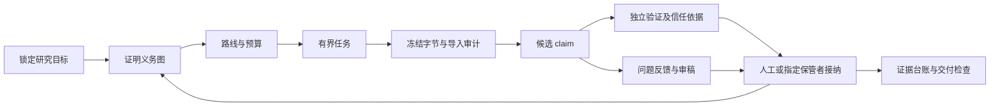

# AI4Math 研究框架架构

AI4Math 0.2 把数学研究拆成目标、证明义务、探索路线、执行任务、证据、验证和交付。它管理研究状态和可检查材料；数学正确性仍来自明确的独立检查器、形式化工具链或人工证明审查。运行依赖为 Python 3.10 及以上和标准库，SQLite 随 Python 提供。

## 对象与边界

| 对象 | 负责的内容 | 不负责的判断 |
| --- | --- | --- |
| node | 精确命题、参数域、finite 或 universal、语义摘要 SHA | 自然语言命题是否与论文意图等价 |
| statement dependencies | 理解命题所需的定义和接口 | 自动视为已证前提 |
| proof dependencies | 当前证明计划要求闭合的子命题 | 自动证明这些子命题足以推出父命题 |
| route | 原理、下一问题、停机条件、执行次数和无进展上限 | 按实验分数宣告定理成立 |
| task | 输入、冻结检查器、argv、时限、日志和执行状态 | 根据退出码升级证据 |
| artifact 与 import receipt | 原始字节副本、SHA、大小、来源和用途 | 只凭文件名或生产者自述信任内容 |
| claim | 对固定命题的结论、证据等级、范围与前提 | 修改已有命题或忽略撤销的前提 |
| validation | 具体检查结果、验证方法与信任依据 | 把模型意见作为数学证书 |
| review | 问题提出、反馈审计、覆盖率和审稿结论 | 替代 validation |
| ledger | 文稿条目到命题、claim 和证据等级的映射 | 自动理解自由文本的全部数学含义 |

node 的 statement、domain、quantifier 和 statement dependencies 创建后不能修改。修改数学含义需要新 node；主目标一经设置即锁定，换题使用新 workspace。proof dependencies 可以通过带原因的 `node.plan` 修改，但必须无环，已提出 claim 的证明计划随之过期；已解决节点要先撤销结论才能重规划。



## 三种状态不能混合

数学证据只有 `proved`、`disproved`、`finite_support`、`unknown`。`proved` 必须绑定精确命题和适用范围；有限问题允许“见证加独立必要下界”或完成的穷尽搜索，全称问题不能用有限扫描闭合。

claim 工作流另有 `proposed`、`accepted`、`revoked`。node 工作流为 `open`、`proved`、`refuted`；看板另输出四级证据字段。接纳 `finite_support` 不会把全称 node 变为已证明。

任务执行状态为 `pending`、`running`、`completed`、`failed`、`unknown_timeout`、`output_limit`、`interrupted`。`completed` 只说明程序正常退出；没有证书的正常退出不会产生数学证明。框架不从求解器日志猜测 FEASIBLE 或 INFEASIBLE 的数学意义；适配器必须区分见证、完整不可行证明和未决超时。

审稿结果为 `ready_for_human`、`revise`、`reject`、`inconclusive`。未完成覆盖，或存在经审计仍成立或未决的 blocking 问题时，不能写 `ready_for_human`。接纳必须使用最新审稿；模型通过审稿也不能替代证明证书。

## 存储与一致性

每个 workspace 是独立目录：

```text
research.sqlite3            追加事件与当前对象投影
objects/ab/<sha256>          内容寻址的字节副本
objects/.incoming/           流式复制的临时位置
tasks/<id>/input.json        固定任务契约
tasks/<id>/PROMPT.md         可交给人工或外部代理的任务提示
tasks/<id>/stdout.log        有上限的标准输出
tasks/<id>/stderr.log        有上限的标准错误
tasks/<id>/result.json       检查器按契约生成的结果
tasks/<id>/return/           托管任务交回的推导、代码、数据及回执
tasks/<id>/live/             托管任务的事件、心跳及运行记录
intake/                     历史接入回执
exports/                    可重建的报告和事件导出
reports/research-summary.md  研究总汇总与下一步
reports/research-history.md  轮次、路线检查点与验收索引
reports/rounds/<id>.json     按轮追加的协调汇总记录
```

写操作使用 `BEGIN IMMEDIATE`，对象投影与事件一次提交。每条事件保存完整变更、前一条事件哈希和本条哈希；数据库触发器拒绝更新或删除事件。并发写者串行提交，审计读使用一致快照。回放事件必须与当前投影一致。

字节先复制到临时文件，边复制边计算 SHA，fsync 后以硬链接发布到对象地址，已有地址不覆盖。登记事务失败可能留下未引用的对象或接入文件；它们不构成证据，当前版本保留这些字节而不自动删除。SQLite 与文件系统不是跨系统原子事务；已登记却丢失的对象会使审计失败。

操作前检查事件和投影；执行、接纳和交付时还检查冻结字节。源文件后来变化不影响冻结副本。恢复备份应在无活动写入时复制整个 workspace；活动数据库应使用 SQLite backup API，并同时保留 objects。仅复制运行中的 sqlite3 文件不是完整备份。

哈希链能检查一致性，不能抵抗拥有数据库和对象目录写权限的人重写全部历史。需要这种保证时，应把 `audit.tail_hash` 发布到仓库之外，并用 `audit --anchor` 核对。actor 是本机归属标签，没有账号认证，也不能从字符串保证不同人员或模型真正独立。

## 执行与恢复

任务使用 argv 数组和 `shell=False`，在独立任务目录执行；外部项目的导入目录不会由框架写入。每次启动在一个事务中占用 route 的一次额度，同一路线禁止同时执行两个任务。时限、输出限额和执行次数是实际约束，stop condition 的数学含义仍须审查。

超时先停止子进程树，Windows 使用指定 PID 的 taskkill，POSIX 使用进程组；清理有额外耗时。这是可信本地程序的运行器，不是操作系统沙箱，无法约束恶意命令、任意文件写入、网络调用、模型账单、内存或主动脱离的子进程。stdout 和 stderr 合计截断；result.json 大小也检查，其他产物的磁盘占用不在本版本限额内。

崩溃后，running 记录保持原状。确认进程已经停止后，使用 `task.recover` 标记 interrupted；需要重跑时新建任务 ID，历史额度不自动返还。运行器不会自动产生后续 Phase、开启新路线或调用付费模型。

## 验证信任模型

程序验证任务必须执行当前 Python 加冻结的 `{validator}` 和 `{input}`；检查 Lean、SMT 或其他工具可以写一个冻结 Python 包装器调用它们。该设计绑定了执行的包装器字节和输入，没有自动冻结操作系统、依赖库、外部二进制及模型版本，应在 `trust_basis` 和检查输出中记录它们。

`finite_certificate`、`exhaustive_search` 只能接纳 finite 范围的 proved；`counterexample` 接纳明确 refutation；`formal_kernel` 需要专用检查器保证内核、声明和假设对应。框架检查结果协议和依赖一致性，不会把任意输出 true 的程序变成可信数学内核。`human_proof` 需要独立署名、具体证明材料和固定的明确审查声明，报告会标记为 human_attestation。

所有验证都保留 trust_basis。独立性除了执行分离和 actor 区分，还需要检查器设计上的独立算法与前提审查。历史项目适配器只读接入冻结记录。示例检查器用独立算法核查生产产物。
