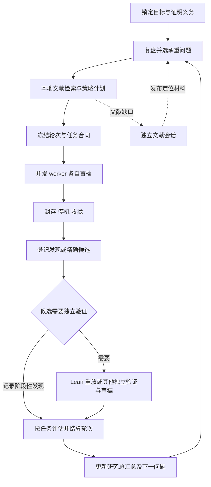

# AI4Math 研究流程设计与实现索引

本文介绍总控如何规划、派工、收拢和续接。运行前请以工作区当前策略、CLI 参数和冻结任务契约为准。文件链接指向框架实现、离线测试和操作说明。

## 总览

每个 workspace 围绕一个锁定目标。总控维护证明计划与跨轮策略，研究 worker 交付具体推导、反例或探针，独立验证者复核精确声明和冻结字节。独立文献会话维护共享学术库，按需给研究会话投递已定位的原文和速览。框架负责约束操作、保存证据与重建状态，报告中的数学判断需要可追溯的验证依据。



图表示总控的职责顺序。先逐项把任务收拢为终态，再评估和结算显式轮次。任务的执行终态与数学声明的验证、审稿和接纳分别登记。

| 对象或状态轴 | 需要保留的内容 |
| --- | --- |
| node / goal | `statement`、`domain`、`quantifier`、`statement_digest`、定义依赖和证明依赖。修改命题含义建新节点，改主目标建新工作区。 |
| approach / route / round / task | 机制设计及其评审、承重路线、轮次的评估单位、可运行的冻结合同。路线、轮次和任务分别有自己的状态。 |
| artifact / import receipt | 原始字节、SHA-256、大小、出处和用途。冻结材料供审稿及独立复核。 |
| claim / validation / review | 候选声明及其证据等级、独立验证的信任依据和审稿结论。工作流状态为 `proposed`、`accepted`、`revoked`。 |
| 数学证据等级 | `proved`、`disproved`、`finite_support`、`unknown`。有限支持的适用域显式登记，接纳后等级仍为 `finite_support`。 |
| 成果成熟度及贡献 | `finding`、`proof_candidate`、`verified` 描述交付成熟度。贡献单独记录，判断结果是否承重、支持或仍处于探索。 |
| 事件与报告 | `research.sqlite3` 中的事件和投影、`objects/` 中的字节、`tasks/` 中的合同和日志、`reports/` 中的派生汇总及轮次交接。 |

文件索引 · [项目规则](../AGENTS.md) · [架构与信任边界](architecture.md) · [CLI 分发](../ai4math/cli.py) · [工作区操作实现](../ai4math/workbench.py) · [事件存储](../ai4math/store.py)

## 研究轮次的规划与控制

### 从主张定位本轮的承重问题

1. 启动或续接时先读目标、未闭合义务、路线、在途任务与已接纳声明。第一次用 `node.add`、`goal.set` 固定目标。用 `node.plan` 调整证明依赖时写明理由，检查图无环并复查旧计划下的候选。定义依赖用于读懂陈述，证明依赖用于表达当前证明计划，父命题如何由子命题推出还要登记推理步骤或相应验证。
2. 总控查看 `strategy-brief`、`strategy-map`、`strategy-schedule`。优先追问一个会改变目标闭合状态的问题，例如“在当前边界假设下，映射是否保留极值不等式”。如果不同机制有可区分预测，先设计足以分流的最小检验。
3. 记录路线的机制、义务、桥梁、可证伪条件、下一问题和预算。研究假设、策略方案和已接纳声明各有登记对象。用 `approach.add`、`approach.review`、`approach.activate` 管理可跨轮的机制，将继续、切换、并行或收窄的理由写入 `strategy.select`。`strategy.decide` 另负责本轮派工焦点。严格写入策略的 `route.add` 还需明确 `kind=proof|exploration`。
4. 通过 `strategy.decide` 绑定当前 `brief_sha256`、决策、理由与下一问题。选中路线须就绪。主路线可以加至多四条并行路线，涉及的义务需彼此不同且满足依赖约束。单路线适合只有一个可行动义务的轮次。待补派工条件时可登记 `switch` 和 `defer_dispatch=true`，以新决定恢复后续派工。
5. 设计新探索前先 `knowledge search`、`show` 并核对原文。启用外部研究门禁时做 `literature.search` 和 `literature.plan`。按工作区策略完成 `method.add`、`method.review`，在 task 中写明 `research_intent` 等当前策略要求。对锁定且未解决的节点用 `exploration.open` 建固定容量池，通过 `exploration.propose` 提交候选及第一项承重检验。
6. 用 `round.open` 登记轮次。在 `task.add` 中用 `round` 绑定所属轮次，适用于本地和托管外部任务。任务按需填写 `exploration_candidate`。先用 `task.preflight` 收集已知阻塞项，再通过 `export-task TASK` 生成 `input.json` 和 `PROMPT.md`。任务实际启动时仍会校验预算、角色、计划、方法和冻结字节。只准备或导出合同可以停在这个检查点，获授权时再按驱动启动。

文件索引 · [目标、路线与任务协议](operations.md) · [策略简报、决策和调度实现](../ai4math/strategy.py) · [方案及其评审](../ai4math/approach.py) · [研究意图](../ai4math/intent.py) · [推理链](../ai4math/inference.py) · [派工预检](../ai4math/preflight.py) · [任务合同模板](../templates/task.json) · [策略回归](../tests/test_strategy_review.py)

### 候选池、探针与变更

候选应写清假设、表示、承重桥梁、反例条件、首检、预计结果如何改变下一步，并绑定冻结的设计材料。修订候选保留父项及修订原因。框架支持 representation、bridge_lemma、construction、discriminating_probe、branch_portfolio 五类能力。结构签名用于提示去重，实质上的机制差异由研究者判断。

`exploration.probe` 登记两个或更多候选的差异预测，预估信息增益用于安排检验。实际结果由冻结回执和 `exploration.feedback` 留痕。需要给程序候选评分时，建池先冻结评价协议、独立检查器和有限域输入。完成的独立验证任务应绑定精确候选、输入与指标，之后才用 `exploration.evaluate` 登记分数。Pareto 前沿表示该协议下的有限评价。

新策略可因负结果生成 `generation.request`。它影响指定路线的研究派工，按实际情况用 `strategy.generate`、`generation.skip` 或 `generation.resolve` 处理。遇到结构性反例或失败时记录障碍、适用域、改动和复核方法，便于后续轮次寻找有效差异。

文件索引 · [探索操作与评价协议](exploration.md) · [候选、探针、反馈和评估实现](../ai4math/exploration.py) · [方法登记及评审](../ai4math/research.py) · [待生成事项](../ai4math/generation.py) · [探索预算回归](../tests/test_exploration_budget.py) · [生成关口回归](../tests/test_generation.py)

### 多层预算与停机

阈值取当前工作区配置。下表给出实现中的默认值和各自计数对象。

| 控制 | 计数及动作 |
| --- | --- |
| 任务限时和输出上限 | `timeout_seconds` 和 `output_limit_bytes` 默认 `null`。需要硬截止时在合同明确写入正整数。启动后按任务合同执行。 |
| 路线运行次数 | 启动即消耗一次路线额度。同一路线只允许一个执行任务在途。Closed 或耗尽的路线保留原记录。 |
| 探索池 | `max_candidates`、`max_tasks`、`max_probes` 分开计数。已绑定任务在创建时占槽，包括绑定的验证任务。准备后未运行、失败、中断均保留占用。 |
| 工作区探索轮预算 | 工作区策略中的 `exploration_budget` 对开了相应策略的 `kind=exploration` 轮次计 reservation。未评估轮次的 abort 可能释放该项 reservation。 |
| 义务 | 运行次数和 checkpoint 跨路线累积。默认连续 12 轮无进展可触发停机。开放义务软阈值为 8，增叶时按门禁填写 `supersedes` 或债务理由。 |
| 例行策略复盘 | 默认每 3 个研究任务终态或在特定信号触发时到期。`strategy.decide` 审查下一数学方向。 |
| 独立长周期关口 | 默认每 20 个路线 checkpoint。到期或 halt 时按独立 `review-gate` 处理，记录 continue、switch、pause 或 close，以及理由和下一问题。继续前同时复查对应义务和路线状态。 |
| 重试及模型对应性 | 默认同路线连续 2 次失败触发停泊及 halt。同一义务到默认 6 次 checkpoint 后，新机制前按规则提交模型到原命题的对应表。机制深度 `min_route_rounds` 默认 1，可显式加严。 |
| 模型和资源 | 独立资源账本记录授权、本次可用额度与消耗。无法计量的驱动保持未知。 |

结算在同一事务内判定进展资格，路线和义务账本共用该判定。计分项包括有独立复核和冻结证据的决策变化，以及当前验证有效的义务闭合。按义务和证据身份去重。任务正常结束、原始 finding 留痕和进展信用各自记录。用独立 `route-assess` 评估数学停止条件并作继续、转向或停止决定。`kill_at` 当前是路线记录字段，执行中的硬上限走任务截止和路线预算。 [进展资格](../ai4math/progress.py) · [有效闭合依据](../ai4math/progress_evidence.py)

文件索引 · [路线与工作区门禁](../ai4math/review_gate.py) · [义务计账](../ai4math/obligation.py) · [失败账本](../ai4math/failure.py) · [对应性](../ai4math/correspondence.py) · [工作区轮次预算](../ai4math/budget.py) · [资源账本](../ai4math/resource_ledger.py) · [关口评审模板](../templates/gate_review.json)

### 轮次结算

显式轮次通常经历 `open → running → ready_to_assess → assessed → settled`，也可有 `aborted`。总控使用 `round.assess` 为每个附属任务分别给出 `execution_status` 与 `scientific_outcome`，记录说明、证据、未检验的预测、主要障碍及下一问题。未运行任务如实记 `not_run`，与失败或超时同样只允许 `not_assessed`。若填 `proved` 或 `disproved`，需引用该任务节点上的已接纳同级 claim。没有派工的尝试可用 `round.record_attempt` 留下发现或无进展记录。

评估和结算分两步。`round.settle` 或恢复入口 `round.recover` 的 `mode=settle` 持久化唯一 checkpoint，更新路线及义务账。重复结算读取既有结果。轮次从未完成有效评估时可按约束用 `mode=abort` 记录原因，仍应独立确认有无在途任务。旧路线保留既有 `route.checkpoint` 记录，新显式轮次使用自身的评估和结算入口。

文件索引 · [轮次状态机](../ai4math/settlement.py) · [轮次结算回归](../tests/test_round_lifecycle.py) · [未运行任务回归](../tests/test_not_run_tasks.py) · [成果结算回归](../tests/test_round_findings.py) · [轮次 checkpoint 模板](../templates/route_checkpoint.json)

## 并发派工与收拢

### 项目 Skill 派工与本地执行

| 入口 | 调度责任与实现 |
| --- | --- |
| `codex-run TASK --library LIB` | 本机 Codex App Server。运行器为任务创建独立线程，动态提供 `ai4math_task` 工具，保存运行时身份、协议流、心跳和结构化进度。参阅 [Codex 运行器](../ai4math/codex_runner.py) 与 [Codex 操作说明](codex-research.md)。 |
| `dispatch-subagent --task TASK --library LIB --host HOST` | 项目 Skill 的原生子代理入口，由实际宿主启动子会话。子会话通过 `worker-task --task TASK --library LIB --action ACTION --payload JSON` 调用同一工具层。参阅 [项目内子代理派工](codex-research.md#项目内子代理派工) 与 [工具服务](../ai4math/mcp_task.py)。 |
| `supervise-external TASK --worker-argv-file FILE` | 通用自有进程监督，按冻结合同管理进程树和截止。参阅 [外部监督器](../ai4math/external_supervisor.py) 与 [期限协议](external-deadlines.md)。 |
| `run TASK` | 运行已注册的本地 argv，独立 validate 通常走此入口。CLI 新建工作区默认要求 explore/produce 走外部文献流程。本地研究需使用显式配置，例如新工作区的 `init --local-research` 或已有工作区 v3.4 策略的 `policy.configure` 中启用 `local_research`。参阅 [执行器](../ai4math/execution.py) 与 [本地研究回归](../tests/test_local_research.py)。 |

同一工作区可并行研究不同就绪义务。主会话统一决定焦点、分配任务 ID 和 actor，每个 worker 只从自己冻结的合同出发。托管合同记录技能清单及哈希、worker actor、允许的 `source_roots`、任务输入与时间和输出限制。技能清单须纳入 `inputs`，使用 broker 工具链时还需在合同登记对应冻结配置。各路线分别放行、封存、验收，早返回的结论先按自己的范围登记。需要整轮结算时，再汇总各任务的真实状态。

跨题统计用 `batch.open`、`batch.add` 和 `batch-status` 聚合各自独立的工作区。人工关口依据当前启用的 `human-checkpoint` 状态。 [输入证据检查](../ai4math/inputs.py) · [人工关口](../ai4math/checkpoint_human.py) · [跨题批次](../ai4math/batch.py)

### 子任务工作协议

1. **领合同。** Worker 使用工具 `contract` 和 `read` 阅读 `input.json`、`PROMPT.md` 及全部适用输入。长内容可分页，页数和展示限制与原始字节哈希分开记录。读输入、搜索文献和调用工具尽量通过任务 broker，使结果可追踪。
2. **独立过文献关口。** 托管任务进入 `literature`。Worker 复核输入，搜索本地学术库，用 `task.literature_ready` 交合同哈希、输入清单、检索、来源、局限和可证伪的首检。v3 回执进入 `awaiting_coordinator_review`。总控核对范围和假设后，用 `task.release_exploration` 绑定准确的 `worker_receipt_sha256` 放行。
3. **只做合同中的问题。** 在 `exploration` 阶段提交结构化进度和可检查产物。诊断、有限实验、证明草图和候选各保留适用域。若需要改变锁定命题、范围或冻结首检，回到总控重新规约。需要补文献时发请求并推进尚可独立完成的检查。
4. **按同一合同封存。** 进入 `task.begin_seal`，提交包含合同哈希与产物哈希的清单。可用 `seal-external TASK --file FILE --check` 检查，或用 `--submit` 按批暂存并提交。原生子代理通过 `seal-subagent --task TASK` 封存 broker 交回。框架核查首次导入时序、原输入、路径约束、实际字节及完整产物集。
5. **核对实际停机。** `sealed` 表示封存完成、待总控验收。以监督器或宿主的确认登记 `task.confirm_stop`。部分失败材料可原样收集，按真实任务状态登记。收到消息、协作暂停请求和有证据的停止确认各有自己的记录。
6. **完成 subagent 交回审查。** 对 `worker_driver=subagent`，总控安排 adversarial 反方审查和 verify 独立复算。按 `review prompt`、`review record`、`review status` 登记已入册的审查者、冻结意见及 verdict。两者均 pass 才满足此驱动的完成门槛。数学声明另走独立验证和 `review.add`。
7. **回收与合并。** 总控用任务 ID、合同和封存清单核对完整产物集，再用派工时的 actor 登记 `task.finish_external`。托管成功的 payload 填 `task`、`status=completed`、`summary`、封存时的精确 `artifact_ids` 及 `seal_manifest_artifact`。审阅 `handoff --task TASK` 及冻结材料，对不同 worker 的适用域、冲突与依赖逐项比对。重复结果合并入同一义务，冲突进入反例、复核或后续探针。若 `basis_read_set` 中的方案、假设或目标摘要已改变，终态可带 `stale_basis`，应复查是否仍能用于当前计划。

文件索引 · [托管合同协议](codex-monitored-contracts.md) · [工具 broker](../ai4math/codex_worker_tools.py) · [总控与 worker 文献关口](../ai4math/literature.py) · [封存批处理](../ai4math/seal_batch.py) · [停机与封存状态](../ai4math/external_deadline.py) · [封存与交回实现](../ai4math/worker_finish.py) · [双评审实现](../ai4math/review.py) · [统一交回记录](../ai4math/handoff.py) · [派工拒绝回归](../tests/test_dispatch_guards.py) · [封存回归](../tests/test_seal_batch.py)

### 总控如何跟踪和纠偏

- 托管 Codex 用 `codex-queue --after CURSOR --wait N` 按任务和事件序号增量查看。初次 cursor 为 `{}`，之后保留原样的返回 cursor。该入口可显示待放行、陈旧心跳、封存待验收和长时间无结构化进度。当前默认观察信号包括心跳陈旧超过约 20 秒和结构化进度约 15 分钟未更新。进度提醒用于人工或协调器诊断。
- `codex-steer TASK --turn TURN --event SEQ --text TEXT` 针对已观测到的任务、执行 turn 和触发事件发送反馈。送达后继续核对 worker 的 `progress` 回执中的确认。用 `codex-control hold|continue|stop` 管理协作暂停和停止。暂停按工具边界生效，等待实际停止确认后再恢复或重派。
- 原生子代理按任务保存跨调用 broker 状态与捕获记录，成功交回后生成 `live/handoff.json`。进度以 broker 回执、`released.json`、注册表和宿主实际子会话状态为准。宿主报出的子会话 ID 和外部工具字节各自保留来源。

文件索引 · [队列与控制实现](../ai4math/codex_live.py) · [实时看板](../ai4math/codex_dashboard.py) · [Codex 队列回归](../tests/test_codex_live.py)

### 托管外部任务如何进入轮次结算

1. `task.add` 可在派工前绑定 `round`。完成封存、确认停机及适用的 subagent 双评审后，总控用 `task.finish_external` 登记执行终态。封存和停机确认期间，任务仍为 `running`。成功完成记录保留 `evidence_level=unknown`，候选材料随后按独立验证和审稿流程处理。
2. `round.assess` 核对本轮全部附属任务。已启动的任务必须先进入终态，确实未启动的任务可登记 `not_run`。声称 `proved` 或 `disproved` 的逐任务评估须引用同节点已接纳的相应证据。并发任务可以分别完成，等本轮附属任务齐备再进入评估。
3. `round.settle` 按已评估记录结算一次，更新路线 checkpoint 与义务账本。已中止轮次允许其在途任务记录真实终态，轮次本身拒绝重新评估。已经终态且尚未绑轮的任务也可通过 `round.attach` 补绑到开放轮次。

先登记实际终态，再评估并结算。 [终态登记实现](../ai4math/workbench.py) · [轮次评估及结算](../ai4math/settlement.py) · [轮次回归](../tests/test_round_lifecycle.py)

本地主线回归涵盖预绑轮次的托管任务、原生子代理、停机和清单拒绝路径。 [离线驱动回归](../tests/test_round_drivers.py)

## 承重问题、首检与策略复盘

### 在策略决定前查看目标变化

```powershell
python -m ai4math --workspace $workspace strategy-brief --goal-impact
python -m ai4math --workspace $workspace strategy-brief --goal-impact --impact-from-event 16062
```

`goal_impact` 是附加的只读投影。默认基线取最近策略决定之前；也可用工作区自身的事件序号固定基线。输出核对事件链，列出两端的尾哈希、证明计划变化、实际闭合、重新开放、新增义务和可复核的决策变化。实际闭合要求当前有效的精确证据，合成证明还须有可信推理。候选成功后仍缺的条件在反事实区直接列出。正式简报的 `brief_sha256` 及派工门禁继续按原接口使用。 [投影实现](../ai4math/goal_impact.py) · [只读与证据回归](../tests/test_goal_impact.py)

### 在冻结合同里标记 scout 与扩张

1. 在 `research_intent.add` 的 `kind=probe` 上附 `scout`。写已登记的 `obstacle`、`goal_interface`、`fragile_condition`、`input_domain`、`verification`，以及 `decisions.success`、`decisions.failure`、`decisions.unknown` 三个不同的预登记决策。`budget` 填正整数 `timeout_seconds` 和 `output_limit_bytes`，任务的实际限制须在该预算内。
2. 探索池中的 scout 再填 `exploration_probe`，使任务同时绑定该探针预登记的候选和冻结设计产物。托管 scout 使用现有 `target_progress_v2` 首检交回协议。交回后用 `round.assess` 的 `eval.intent` 和 `eval.prediction_match` 将观察对应到冻结意图。 [探索探针](../ai4math/exploration.py) · [首检交回](../ai4math/research_return.py)
3. 已标记的 `domain_scan` 或 `batch_formalization` 扩张，在新 `research_intent` 的 `expansion` 中引用 `scout_task`、`decision`、`input_domain` 与 `budget`。首检须正常完成并结算。用既有 `review record --role adversarial` 与 `review record --role strategy` 分别登记反例挑战和原目标连接审查，审查者彼此及与任务作者、执行者分离。策略审查者冻结的 JSON 须准确写出 `kind`、`scout_task`、`input_domain`、`budget`。两件审查 artifact 都是扩张任务的冻结输入。总控在两件审查之后登记当前策略决定。`domain_scan` 对应探索或生产任务，`batch_formalization` 对应验证任务。 [意图及扩张准入](../ai4math/intent.py) · [合同导出与启动复核](../ai4math/execution.py) · [独立审查](../ai4math/review.py)

完成并有产出的 scout 按稳定 `obstacle` ID 与策略决定归并。两次实质批次都没有同一瓶颈的决策增量时，通过既有 `generation.request` 请求复盘。经复核的路线反驳或接口重述也可触发。证明者、反例审查者和桥梁审查者引用同一冻结陈述，独立审查功能负责呈现选择依据，总控仍通过现有策略决定安排行动。小型未标记承重任务沿用原有合同门禁。 [生成门禁](../ai4math/generation.py) · [预算、复盘与对照回归](../tests/test_bottleneck_probe.py)

### 先做离线对照，再评估是否晋升

离线对照将每一对夹具从同一有哈希的 checkpoint 恢复到独立目录。B 使用原任务入口，C 使用这个扩张准入策略。逐对检查未执行、未检验、过期决定、缺审查、未冻结审查、预算变更及已批准场景。结果用于验收准入与状态不升级。实际研究对照需另行冻结留出集与授权预算，通过现有 `study` 配对盲审评估重复探索成本与承重推进。晋升须满足零观测误接纳、至少一项预登记改善和关键决策无回退。 [对照夹具](../tests/test_bottleneck_probe.py) · [截点恢复](../ai4math/checkpoint.py) · [配对协议](benchmark-operations.md)

离线回归用合成夹具覆盖首检扩张、预算和失败后的决策。正式闭合以各工作区的登记证据为准。 [首检回归](../tests/test_bottleneck_probe.py)

## Lean 4 形式化、独立验证与接纳

### 什么时候投入形式化

在一轮只得到反例条件、表示变化、障碍或可复核探针时，用 `finding.add` 保存发现，标明适用域和实际证据。承重引理具有明确参数、假设、结论和可实现的草图后，冻结材料并提交 `claim.add`。候选一开始为 `proof_candidate`。成熟度、证据等级和最终贡献分别记录，`verified` 也可以描述已经按其有限范围验收的有限支持。

| 触发 | 当前动作 |
| --- | --- |
| `proof_sketch_ready` | `claim.add` 带非空、已冻结的 `proof_sketch` artifact ID 列表时自动创建待办。草图供复核，实际要验证的产物同时登记到 claim 的 `artifact_ids`。 |
| `accept_attempt` | 总控准备尝试正式接纳、还缺独立验证时，以 `formalization.request` 显式登记。 |
| `bridge_proposed` | 承重桥梁的精确陈述和输入已冻结时，由调用方显式登记。 |
| `manual` | 确有验证价值的候选由协调者显式登记，写清为何现在做。 |

`formalization.request` 绑定 proposed claim、trigger、reason。已有 pending 分配时返回同一记录，默认每个 claim 可登记 2 次请求。当前超额会报错。该计数针对请求，不分配实际 Lean 时间，也不会自动启动工具。待办通过 `formalization.resolve` 引用同一 claim 已登记的通过验证，或以 `formalization.skip` 记录原因和可选证据引用。接受声明可消费待办，撤销声明会将仍待处理的请求标记为 stale。通过验证可以有不同方法，关单时需查看实际验证依据。

文件索引 · [发现实现](../ai4math/findings.py) · [成熟度实现](../ai4math/maturity.py) · [触发与预算实现](../ai4math/formalization.py) · [工作区策略](../ai4math/policy.py) · [形式化回归](../tests/test_formalization.py) · [分级演示](../scripts/maturity_demo.py)

### 独立 Lean 验证的执行顺序

1. **锁定要检查的命题。** 在目标节点登记数学陈述、定义域及 Lean 声明，按需写 `lean_statement`、`lean_type`。确认 Lean 表达式的参数、量词、假设和结论与数学目标一一对应。候选声明绑定节点当前的 `statement_digest`、范围、证明产物和已接纳依赖。直接证明用 `proof_route=direct`，子引理合成用 `composition` 并提交相应的 entailment 或 inference 依据。
2. **明确工具链与信任依据。** 有固定工具链合同的环境可用 `lean-preflight --file FILE` 核对 Lean 可执行文件及版本、探针和依赖清单的哈希，运行版本和直接依赖检查。可用 `checker.policy.add` 约束检查器哈希、版本、公理和证书格式，用 `verification.policy.add` 指定该类声明能依赖的验证基础。导入前缀预检另见 [check_imports.py](../scripts/check_imports.py)。
3. **冻结独立检查器与输入。** 验证者用自己的 actor 登记 `task.add` 的 validate 任务，`validator_artifact` 指向冻结 Python 包装器，`inputs` 包含完整 claim 产物。标准 argv 为 `[当前 Python 的绝对路径, "{validator}", "{input}"]`。用 `export-task` 生成冻结合同，再由独立验证者 `run TASK`。已配置共享 Mathlib 环境时，重放包装器可以用 `AI4MATH_LEAN_PROJECT` 指向已构建的 Lake 项目。
4. **绑定实际 Lean 重放。** 包装器读取冻结合同，针对指定 Lean 文件和声明重放。节点含 `lean_statement` 时核对文字绑定，然后查询指定声明。节点含 `lean_type` 时比较规范化的打印类型，并默认追加 `Meta.isDefEq` 的定义等价探针。仅在快速回放显式设置 `AI4MATH_EXPR_CHECK=0` 时跳过后者。缺少 `lean_type` 时没有该目标类型的定义等价对应。通过 `#print axioms` 检查解析到的公理并拒绝 `sorryAx`，检查器信任策略可要求完整公理列表和允许集。
5. **归档回执并审稿。** `result.json` 绑定 task、声明摘要、精确输入 ID、方法、范围和证据等级，包含 checks 与 limitations。重放包装器可记录 Lean 版本、工具链指纹、声明类型摘要、axioms 和 expr_check。独立验证者用 `validation.add` 绑定已正常完成的验证任务及明确的 `trust_basis`。审稿者通过 `review.add` 检查声明、前提、覆盖、反例与审计，最终由符合角色区分的保管者执行 `claim.accept`。
6. **核对后续可用性。** 使用 `provenance --claim CLAIM` 查看历史验证、当前策略认可、工具链差异、依赖撤销和有效性。策略改变可能需要 `verification.recheck` 及新的独立回执。依赖撤销时保留历史，递归核对下游结论能否继续使用。

Lean 检查器稳定核对的是已绑定形式化声明。数学文意、Lean 编码与原问题的对应仍需要审查，退出码、`ready_for_human` 或回执中的通过字段分别属于流程记录。若以 `human_proof` 为依据，要有确实核对过精确陈述、适用域、依赖和证明的独立人员及其实际 attestation。有限证书和有限穷举只覆盖所声明的有限问题。

文件索引 · [独立验证操作协议](operations.md) · [Lean 依赖预检](../ai4math/lean_preflight.py) · [Lean 重放检查器](../scripts/lean_replay_checker.py) · [checker 信任规则](../ai4math/trust.py) · [验证依据规则](../ai4math/verification_policy.py) · [验证投影、溯源与复核](../ai4math/verification.py) · [声明绑定回归](../tests/test_checker_binding.py) · [信任策略回归](../tests/test_verification_policy.py) · [失效与重新验证回归](../tests/test_recheck.py)

运行 Lean 重放检查器时，可通过 `AI4MATH_LEAN_PROJECT` 指定已安装所需依赖的项目。回执记录实际的表达式检查结果与公理列表。 [检查器绑定回归](../tests/test_checker_binding.py)

## 总控会话如何跨长轮次续接

### 按信息载体恢复

| 信息载体 | 续接时核对 |
| --- | --- |
| `research.sqlite3` 和 `objects/` | 主目标、声明和假设版本、证明依赖、实际终态、预算与已冻结证据。事件和投影在单一数据库事务中更新，受同一哈希链约束。 |
| `strategy-brief` 和 `strategy-map` | 目标当前摘要、策略复盘、关口、焦点路线、未决信号和研究依据。新决定带当时取得的 `brief_sha256`。 |
| `reports/research-summary.md` | 接手时的范围、实际到达进展、仍缺的推导和首个具体动作。若登记与渲染不同步，以注册表为依据，按需刷新汇总。 |
| `reports/research-history.md`、`reports/rounds/*.json` | 逐轮查已发生的推导、失败、适用域及链接。作者显式记录的交接与系统可重建的投影同时可查。 |
| `research-ledger.jsonl` | 用 `ledger record --task TASK` 从已完成且已封存任务提炼 question、method、observed、falsified、open_obligations。用 `ledger show`、`ledger digest` 读取；这是显式动作。 |
| 运行记录与文献投递 | `codex-queue` 保存各任务事件游标，学术库 inbox 保存最新已读的 `delivery_seq`。用对应游标恢复增量读取。 |

上下文打包器可将锁定陈述、参数域、量词、证明依赖、近期 ledger、待查文献和有限数量的开放义务装入冻结材料。严格写入策略下由 `research_intent.add` 记录本次问题、目标连接和停机条件，保存 `basis_read_set`，供回收时检查相关方案、假设与目标的修订。新 worker 读取本轮授权范围内的精确材料，额外旧记录按需展开。

文件索引 · [项目 Skill 和新命题入口](codex-research.md#新命题验收) · [总控技能](../.agents/skills/ai4math-coordinate/SKILL.md) · [worker 技能](../.agents/skills/ai4math-research/SKILL.md) · [策略投影](../ai4math/strategy.py) · [上下文包](../ai4math/context.py) · [研究 ledger](../ai4math/ledger.py) · [依据读集](../ai4math/intent.py) · [汇总实现](../ai4math/research_summary.py) · [汇总回归](../tests/test_research_summary.py)

### 每轮将哪些内容写回

`summary --record FILE` 接受 `kind=review|pause|historical` 及 `progress`、`scope`、`gaps`、`next_step`。填写任务和 claim ID、冻结 artifact ID、本轮实际使用的 passage ID。通过 `--library LIB` 定位原文，或使用工作区已有的附加片段。暂停记录要说明最后确认的动作、仍在途的任务、未确认停止和恢复后先做哪一项。

不带 `round` 的新记录以 ID 追加，内容相同可重试。带 `round` 和 `status` 时，当前投影将同轮收拢为一条并保留状态转换。原始证据和注册表事件各自保留。报告在一致读取后分别原子写出，报告刷新失败时重新运行 `summary` 即可再生成。既有冻结历史材料的访问按各自留存规则执行。

### 会话压缩、暂停或出错后的接手顺序

1. 确认同一个 workspace、goal、statement digest、domain 和当前 proof plan。核对最新评审后再做新决策。
2. 读取汇总的进展、范围、缺口和 next_step。回到对应 claim、validation、封存材料及推理链，核对可能改变决策的那几项。
3. 核对在途、封存待回收、已停止、待验证和未评估轮次。进程崩溃后仍显示 running 时，先求证进程确实停止，再用 `task.recover` 如实标为 interrupted。需要重做时分配新任务，历史预算继续有效。
4. 读 `strategy-brief` 的 gate、义务、路线上限和当前决策；读近期失败账与已排队的生成义务。如果当前计划与上一轮不同，核查 stale_basis 和失效依赖。
5. 从保存的 `delivery_seq` 读新文献结果，复核迟到信息与当轮初始假设的关系。用准确的新基线冻结下一份合同。

需要克隆一个可审计的评测分支时，使用 `checkpoint export` / `checkpoint restore` 和清单校验。正常接手沿原工作区读取状态即可。冻结工作区的严格只读检查可以直接使用现有报告或 `Workbench(..., read_only=True)`。 [恢复操作](operations.md) · [运行中断恢复](../ai4math/workbench.py) · [检查点与继承](../ai4math/checkpoint.py)

## 数学文献的采集、管理和复用

### 库的对象和版本

默认本机库位于 `data/academic/`。学术库用独立的 SQLite、追加事件和内容寻址对象，研究工作区通过显式选择或授权检索使用它。

| 对象 | 用途与登记入口 |
| --- | --- |
| source | 书目身份、URL、提供方元数据及出处。通过 `knowledge add-source` 或 `knowledge discover` 登记。DOI、arXiv 别名用于聚合检索结果。 |
| document | 原件内容、关联 source、原件 SHA-256 和版本。用 `add-document` 流式保存完整字节。适合索引的文本和 HTML 可自动提取带定位片段，PDF 完整归档后用 `add-passage` 补关键段落。 |
| passage | 引用时确切阅读的章节、页码、定理号或片段，绑定原件 ID。外部提取或人工转录的片段仍需和同一版本原件核对。 |
| paper_profile | 对已读段落的速览，记录摘要、贡献、领域、关键词、方法、假设、局限和锚点。用 `add-profile` 创建，修订同一原件资料时用 `supersedes`，旧版保留。 |
| mechanism card | 提取可尝试的研究机制、约束与风险，控制候选池检索与复用。用 `add-card`，归档来源也随卡绑定。 |

元数据、速览和机制卡为检索与判断适用性的输入，库内证据标记为 `unknown`。全文人工阅读和数学假设核对留在转移记录及验证环节。新原件版本生成独立记录；规范 JSON 与原始字节的哈希区分内容版本。

文件索引 · [资料库对象与词法检索](../ai4math/knowledge.py) · [独立库初始化和检索操作](exploration.md) · [文献对象和速览示例](literature-workflow.md) · [附加模板](../templates/knowledge_attach.json) · [资料库回归](../tests/test_knowledge.py)

### 检索与采集

1. 总控按当前承重问题搜索。用 `knowledge --root LIB search --kind scan --query QUERY` 联查来源、段落、paper profile 和机制卡，也可指定 `source`、`mechanism` 或 `passage`。本地按词项排序，通过 `show --kind KIND --id ID` 阅读完整选中记录。
2. 遇到新来源缺口时，授权范围内对 Crossref 或 arXiv 发起一次明确的 `discover --provider PROVIDER --query QUERY`。命中已有成功查询会用缓存。需要重查时用 `--refresh` 并计入固定配额。新请求的参数范围为 1–20 条、1–30 秒和 2 MiB 响应上限。失败照计，未完成的 pending 请求保留并用 `knowledge recover` 显式处理。结果保存为带出处的 metadata。
3. 文献会话选择并取得可访问的确切原件，用 `add-document` 归档后核对关键段落。用 `review-queue` 找到 `needs_passage` 或 `needs_profile` 原件，在对应位置登记片段和速览。新卡填写迁移假设、可试探针和失效条件。
4. 在研究工作区用 `knowledge.attach` 指定 library、reason、1–8 张 `card_ids` 及所需的 `document_ids`、`passage_ids`、`profile_ids`。文档来自选中卡关联的 source，速览和片段属于所选文档。继续受 `allowed_roots` 与任务 `source_roots` 约束。
5. 若要用原文机制关闭某项义务，用 `exploration.transfer` 写原文摘录、定位、成立条件、条件到本题的映射和仍缺的桥梁。此接口检查文本提取版原件的摘录匹配。PDF 或手工片段应回到归档原件核对；若要走严格 transfer 接口，还需合规的可检索原件记录。后续候选、失败反例与修订在池中串联，最终靠工作区的独立验证与声明接纳闭合。

文件索引 · [元数据网络请求和原件导入](../ai4math/knowledge.py) · [选择性附加与数学迁移](../ai4math/exploration.py) · [来源和机制卡模板](../templates/academic_source.json) · [机制卡配置](../templates/mechanism_card.json)

### 独立文献会话与两次研究关口

总控把未解决的缺口写成 `question`、`assumptions`、`queries`、`purpose`。问题和假设相同可共用请求，路线各自保留订阅、已查线索和研究用途。文献会话以独立 actor 领取请求，记录实际检索和结果。主会话与 worker 可在下一检查点回收。

```powershell
python -m ai4math --workspace $workspace --actor coordinator knowledge --root $library request --route $route --file gap.json
python -m ai4math --actor literature-curator knowledge --root $library request-claim
python -m ai4math --actor literature-curator knowledge --root $library request-finish --id $requestId --attempt $attemptId --file result.json
python -m ai4math --workspace $workspace knowledge --root $library inbox --status published --after $deliverySeq
```

文献会话的 `found` 结果引用该库中已登记的文献速览，速览绑定原件与片段。`no_match` 说明检索覆盖，`blocked` 记录缺口，`interrupted` 留下本次尝试并将请求回队。Worker 通过 `request_literature` 和 `literature_updates` 使用任务绑定的视图。已发布结果以 `delivery_seq` 增量分发，协调者持久保存已核对到的序号，并按需给新合同冻结选中片段。

| 关口 | 何时登记及如何放行 |
| --- | --- |
| 研究总控派工前 | 每条焦点路线按当前 `strategy.decide` 用 `literature.search` 登记真实检索。检索材料由同一 actor 在决定后首次冻结。然后 `literature.plan` 绑定全部且仅包含当前路线，覆盖现有来源、已知局限和可做的首检。选中路线的待派研究任务在计划齐备后才能准备、导出和启动。 |
| worker 首检前 | Worker 在该任务冻结后独立查库和读输入，冻结自己的检索材料，提交 `task.literature_ready`。总控按回执哈希与适用性逐任务放行。 |

两次关口都依据当前可得文献。异步请求尚未返回时，可以推进与缺失来源独立的推导和探针。依赖未获得文献的特定义务保持开放。来件被引用前核对题设与原文，如只影响后续任务，在下一版合同附加精确版本与段落。

文件索引 · [共享 inbox 与投递游标](../ai4math/literature_inbox.py) · [两次门禁实现](../ai4math/literature.py) · [worker 文献工具](../ai4math/codex_worker_tools.py) · [文献会话技能](../.agents/skills/ai4math-literature/SKILL.md) · [异步队列回归](../tests/test_literature_inbox.py) · [研究托管合同回归](../tests/test_codex_monitored_contract.py)

## 复盘、交付和故障定位

| 想判断什么 | 查看位置 |
| --- | --- |
| 当前最承重的开放义务和卡点 | `strategy-schedule`、`strategy-map` 和 `health`。调度结果供总控判断。结合目标锥和闭合度看进展，避免单看轮数、字数或通过数量。参阅 [健康面板](../ai4math/health.py)、[指标与读数](../ai4math/metrics.py)、[闭合度实现](../ai4math/metrics_closure.py)。 |
| 某个结论为何能用、能用到哪里 | `provenance --claim CLAIM` 回到冻结输入、信任来源、推理链与当前有效状态。`diagnose --node NODE` 定位反例影响、见证和定理条件。参阅 [验证溯源](../ai4math/verification.py) 和 [诊断实现](../ai4math/diagnosis.py)。 |
| 某次真实运行是否正确完成 | 检查运行日志、任务协议、封存清单、导入审计和停止确认。`audit` 核对事件回放、投影和冻结对象，外部持有的尾哈希可用于核对固定快照。参阅 [存储与审计](../ai4math/store.py)、[托管封存](batch-seal.md)、[事件存储回归](../tests/test_store_failpoint.py)。 |
| 目标和论文是否具备交付条件 | 对稿件中的结论用 `ledger.add` 绑定精确 node、已接纳 claim 和用途。稿件台账与 `research-ledger.jsonl` 分别服务交付和会话续接。用 `delivery-check` 核对目标、证据状态和稿件条目。旧 Phase gate 的约束与当前工作区的运行关口各有入口。参阅 [交付实现](../ai4math/workbench.py)、[旧阶段 gate](../ai4math/gate.py) 与 [有限证据示例](../examples/run_finite_demo.py)。 |

复盘长期停滞、预算消耗与模型对应性时，以工作区的冻结证据、独立评审和已结算轮次为据。
